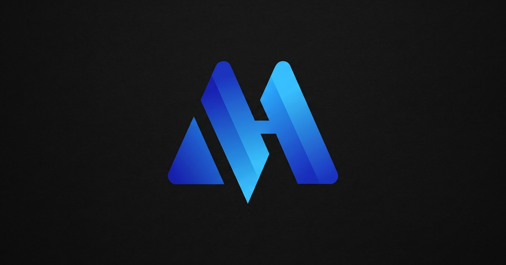

<div align="center">



<br/>

# 🌊 Hirumal Marasinghe

### Data · Design · Community · Leadership

*A student perspective. A shared purpose.*

<br/>

[](https://www.linkedin.com/in/hirumal-marasinghe-111a7135a)
[](https://www.instagram.com/_h1rum4l_)
[](https://www.facebook.com/share/18V2zboYzj/?mibextid=wwXIfr)
[](mailto:marasinghehirumal4366@gmail.com)

</div>

---

## 👋 About Me

I'm a **BSc (Hons) Data Science and Business Analytics** student at **General Sir John Kotelawala Defence University (KDU)**, Sri Lanka (2025–2029).

My interests span **machine learning**, **design**, and **volunteer work**. Alongside my studies, I contribute to student communities through finance, logistics, and leadership roles.

| | |
|---|---|
| 🎓 **Studying** | BSc (Hons) Data Science and Business Analytics, KDU |
| 📍 **Based in** | Sri Lanka 🇱🇰 |
| 🔭 **Interests** | Machine learning · Design · Community work |
| 💬 **Values** | Respect · Leadership · Communication · Human connection |

---

## 🏆 Achievements & Initiatives

| | Initiative | Role | Year |
|---|---|---|---|
| 🌱 | **Artha 2.0** — community initiative bridging the digital divide for rural students | Finance Co-Lead | 2026 |
| 🎨 | **Cre8X 2.0** — inter-university UI/UX designathon by the BCS Student Branch at KDU | Finance Lead | 2025 |
| 🏭 | **Step Into Industry 4.0** — connecting academia and industry | Logistics Team | 2026 |
| ⭐ | **Volunteer of the Month** — IEEE Student Branch, KDU | Recognition | March 2026 |

---

## 🧭 Leadership & Roles

- 💼 **Assistant Treasurer** — British Computer Society (BCS) Student Chapter, KDU *(Feb 2026 – Present)*
- 🤝 **Volunteer & Membership Task Force Chair** — IEEE Student Branch, KDU
- 🌍 **Community involvement** — IEEE Young Professionals Sri Lanka
- 💰 **Finance Co-Lead** — Artha 2.0
- 💰 **Finance Lead** — Cre8X 2.0
- 📦 **Logistics Team** — Step Into Industry 4.0

---

## 📜 Certification

🤖 **Introduction to Artificial Intelligence** — SLIIT City UNI
Issued March 2025 · Credential ID: `SCU_IAI_632`

---

## 🛠️ Tech Stack

<div align="center">


</div>

| Layer | Tools |
|---|---|
| ⚛️ **Framework** | React 19 + TypeScript |
| ⚡ **Build tool** | Vite |
| 🎨 **Styling** | Tailwind CSS 4 |
| ✨ **3D & motion** | Three.js (starfield hero), Motion |
| 🔤 **Typography** | Poppins · Inter · Michroma |

---

## 🎨 Design Notes

- 🌌 **Deep-sea palette** — dark oceanic background (`#020B14`) with a cinematic, atmospheric feel
- 🖼️ **Feathered portrait** — hero portrait dissolves smoothly into the background using CSS alpha masking
- 🌠 **Three.js starfield** drifting behind the hero section
- 📱 **Fully responsive** with mobile-specific assets
- ⏸️ **Pause ambient motion** control for accessibility

---

## 🚀 Run Locally

**Prerequisites:** [Node.js](https://nodejs.org/)

```bash
# 1. Clone the repository
git clone https://github.com/<your-username>/<your-repo>.git
cd <your-repo>

# 2. Install dependencies
npm install

# 3. Start the dev server
npm run dev
```

The site will be available at **http://localhost:3000**.

```bash
# Production build
npm run build

# Preview the production build
npm run preview
```

---

## 📁 Project Structure

```text
├── assets/             # Portrait, logos, backgrounds, achievement images
├── public/assets/      # Static assets served by Vite
├── src/                # React entry (main.tsx, App.tsx, index.css)
├── index.html          # Single-file cinematic portfolio page
├── vite.config.ts
├── tsconfig.json
└── package.json
```

---

## 📬 Let's Connect

Get in touch about **data**, **design**, or **community work**.

<div align="center">

[](https://www.linkedin.com/in/hirumal-marasinghe-111a7135a)
[](https://www.instagram.com/_h1rum4l_)
[](https://www.facebook.com/share/18V2zboYzj/?mibextid=wwXIfr)
[](mailto:marasinghehirumal4366@gmail.com)

<br/>

**Data. Design. Human connection.**

© 2026 Hirumal Marasinghe

</div>
